<h1 align="center">miaoshu-gzh-design · 喵叔公众号排版技能</h1>

<p align="center"><b>把写好的 Markdown 一键排成能直接粘进公众号编辑器、粘完不掉格式的 HTML</b></p>

<p align="center">8 套主题 · 产品选购清单组件 · 行业合规词检查 · 自检脚本</p>

<p align="center">
  <a href="LICENSE"></a>
  <a href="SKILL.md"></a>
  <a href="docs/THEMES.md"></a>
  <a href="#-快速开始"></a>
</p>

---

这是一份交给 AI Agent 用的排版 skill。你把文章写成 Markdown，Agent 读 `SKILL.md` 按文章类型推荐一套主题、等你点头，再调用本仓库的 Python 引擎生成**样式全部内联**的公众号 HTML：浏览器打开点「复制到公众号」，到编辑器里一粘就是成品，标题、卡片、表格都不会被吃掉。它出身于保险科普号「喵叔说保」，所以自带保险禁用词扫描和「以保险合同条款及核保结果为准」的免责必含检查；别的行业把 `engine/checker.py` 里的词表换成自己的，整套流程照样能用。

## ✨ 核心特性

- **8 套成体系的主题**：日常科普、测评读物、数据测算、清单指南、保单诊断、知识笔记、产品横评、选购清单，每套都有自己的头图、章节样式、色板和组件，按文章类型对号入座。
- **一套标记语法通吃 8 套**：同一份 `.gzh.md` 标记稿换个主题 id 就能重排；某套主题没有的专属组件会自动降级为段落或表格，不会报错。
- **产品选购清单组件 `::: products`**：分类横幅＋产品卡＋「标签：正文」要点，「适合人群」自动高亮；⑧ 选购清单是它的主场，其余 7 套也都有按各自色板渲染的版本。
- **原文一字不改**：推荐用 `compose.py` 按段号拼标记稿，构建时再把排版结果和原文逐句比对，漏一句、改一字都会列出来。
- **公众号兼容从严执行**：只用 section / p / span / table 等安全标签，文字全部 `<span leaf="">` 包裹，不用 div、class、flex、grid、定位和渐变，由校验器逐条检查。
- **行业合规检查**：保险禁用词（回本、收益、最高、第一、排名……）在排版新加的文字里出现即报 ERROR，原文已有的只提示不改；免责缺失直接报错。
- **375px 手机版面自检**：自动截长图，并检查段末孤字、行首标点、横向越界和容器溢出。
- **一次出三样**：带复制按钮的 `article.html`、干净正文 `body.html`、手机预览长图 `preview.png`，外加一份 `check.txt` 校验报告。

## 👀 效果预览

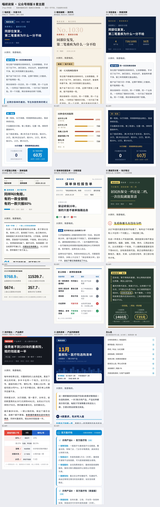

每套主题用最契合的一篇真实文章排版（点缩略图看完整长图）：

|  |  |  |  |
|:-:|:-:|:-:|:-:|
| <a href="docs/previews/1-miaolan-full.jpg">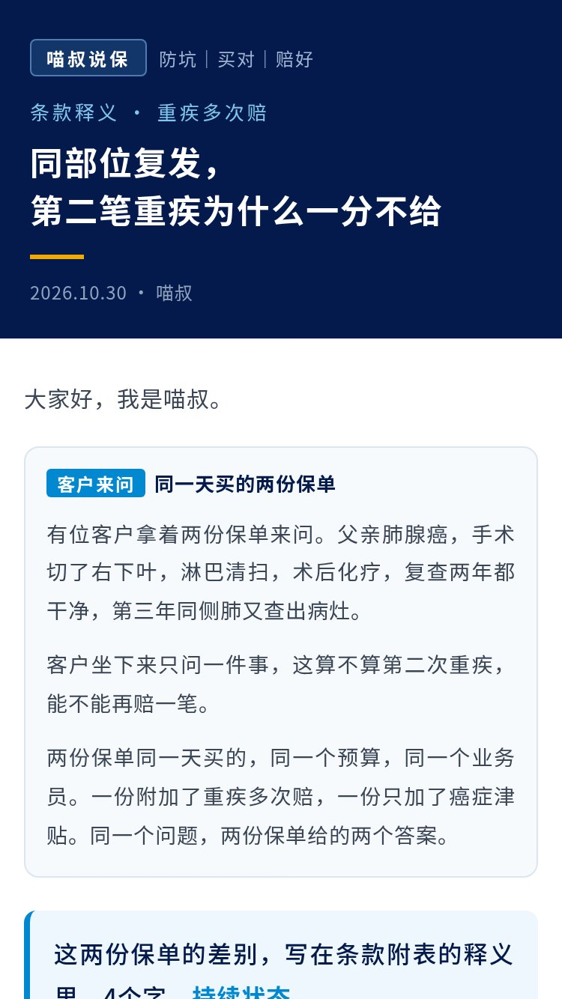</a> | <a href="docs/previews/2-nuanzhi-full.jpg">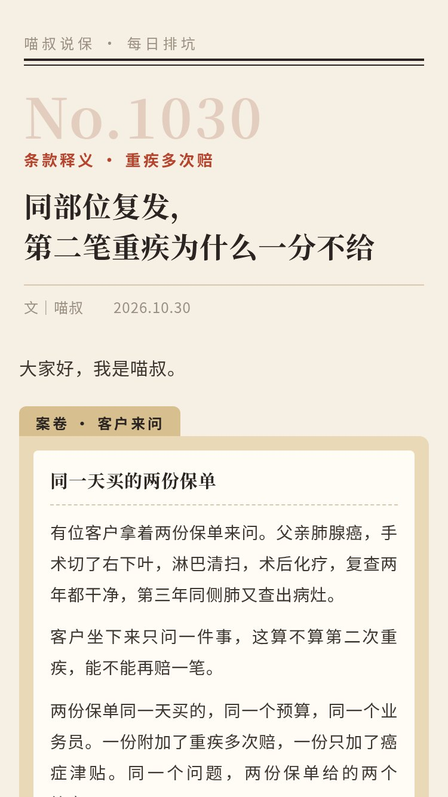</a> | <a href="docs/previews/3-shenlan-full.jpg">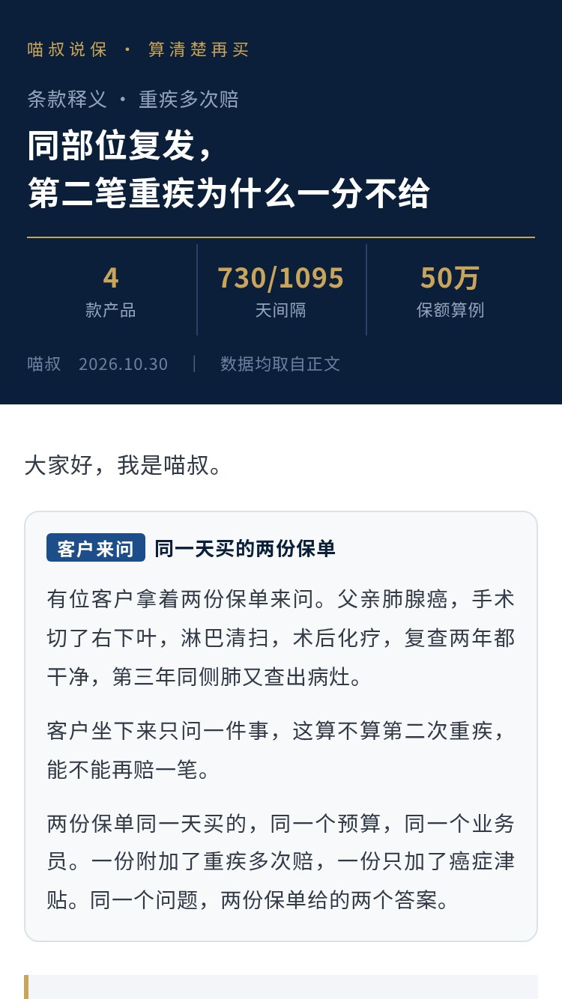</a> | <a href="docs/previews/4-wangge-full.jpg">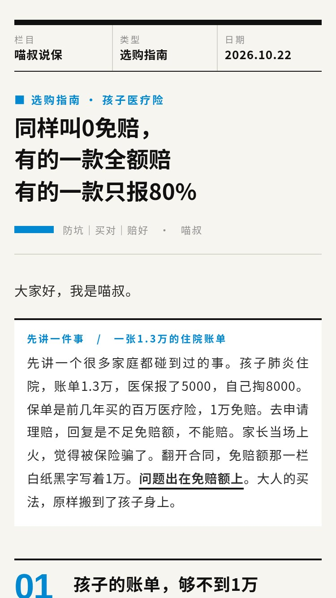</a> |
| **① 喵叔蓝**<br>`miaolan` | **② 暖纸编辑**<br>`nuanzhi` | **③ 深蓝鎏金**<br>`shenlan` | **④ 瑞士网格**<br>`wangge` |
| <a href="docs/previews/5-tijian-full.jpg">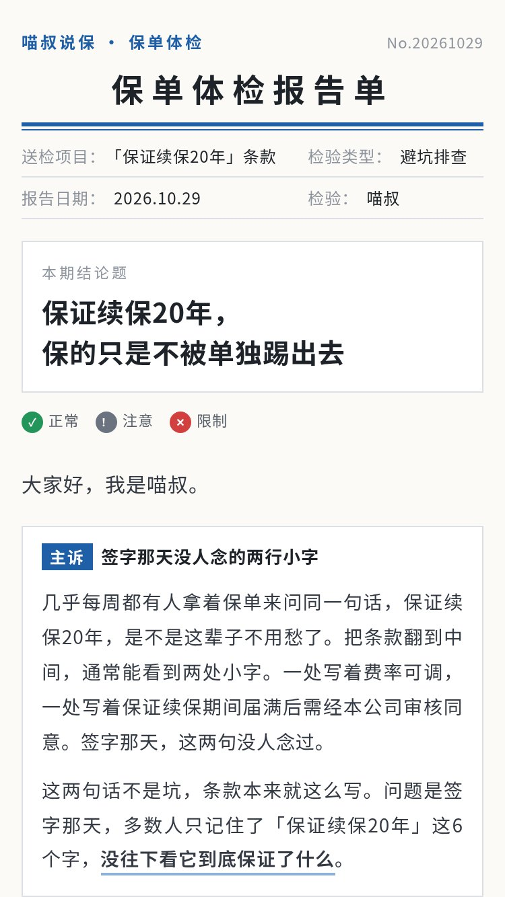</a> | <a href="docs/previews/6-heiban-full.jpg">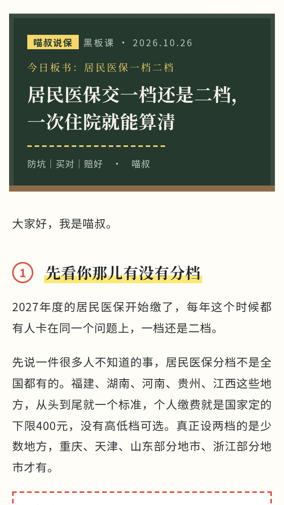</a> | <a href="docs/previews/7-leitai-full.jpg">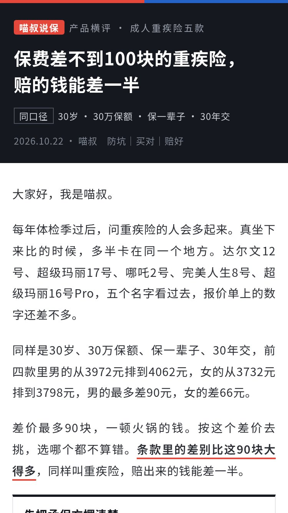</a> | <a href="docs/previews/8-xuangou-full.jpg">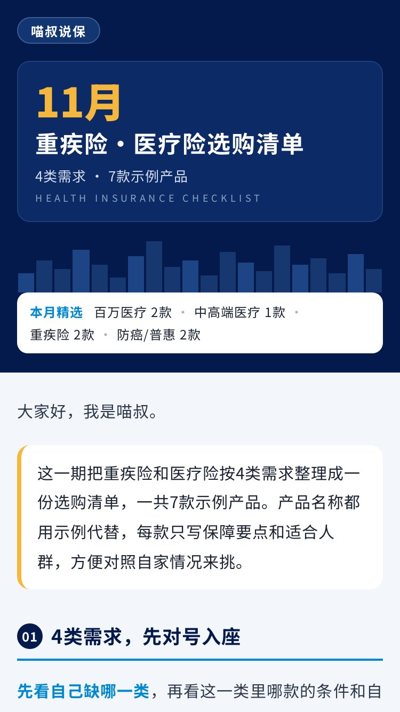</a> |
| **⑤ 体检报告单**<br>`tijian` | **⑥ 黑板荧光笔**<br>`heiban` | **⑦ 测评擂台**<br>`leitai` | **⑧ 选购清单**<br>`xuangou` |

## 🗂 常见场景 → 推荐主题

| 你的文章 | 首选 | 备选 |
|---|---|---|
| 日常条款释义、家庭场景避坑 | ① 喵叔蓝 `miaolan` | ⑤ 体检报告单 |
| 案例复盘、观点长文、深度测评 | ② 暖纸编辑 `nuanzhi` | ⑦ 测评擂台 |
| 养老 / 年金 / 分红 / 退休现金流测算 | ③ 深蓝鎏金 `shenlan` | ⑥ 黑板荧光笔 |
| 选购指南、「先看什么后看什么」的排序型清单 | ④ 瑞士网格 `wangge` | ① 喵叔蓝 |
| 保单诊断、免责排查、政策/条款原文逐段解读 | ⑤ 体检报告单 `tijian` | ① 喵叔蓝 |
| 医保怎么选、名词解释、带公式的科普 | ⑥ 黑板荧光笔 `heiban` | ③ 深蓝鎏金（纯算账时） |
| 多款产品横评、两款 PK、单品拆解 | ⑦ 测评擂台 `leitai` | ② 暖纸编辑（偏读物时） |
| 月度选购清单、按需求分类的产品推荐 | ⑧ 选购清单 `xuangou` | ④ 瑞士网格 |

建议主力用 ①，每周按文章类型轮换 ④–⑧ 中的一套，同一套不连用超过 3 篇。

## 🚀 快速开始

### 方式一：一行安装

```bash
npx skills add https://github.com/waitmi/miaoshu-gzh-design
```

### 方式二：让 Agent 自己装

对 Claude Code / Codex / Cursor 等任意 Agent 说：

> 请帮我安装 https://github.com/waitmi/miaoshu-gzh-design 这个 skill

### 方式三：手动 clone

```bash
git clone https://github.com/waitmi/miaoshu-gzh-design.git ~/.claude/skills/miaoshu-gzh-design
cd ~/.claude/skills/miaoshu-gzh-design
pip install -r requirements.txt
playwright install chromium        # 或设置 GZH_CHROMIUM=/path/to/chromium
```

装好后直接对 Agent 说：

> 用喵叔蓝把 article.md 排成公众号 HTML

## 📖 使用流程

1. **选主题**：Agent 读完文章，按上面的场景表给出首选＋备选和一句理由，你确认后再动手（直接点名主题也行）。
2. **写 / 给 Markdown**：你提供原文；Agent 用 `compose.py` 按段号把原文拼进标记稿，只加章节、卡片、表格、产品列表等结构，不改原文。
3. **生成**：`python3 scripts/build.py <主题id> 文章.gzh.md --src 原文.md` 一次产出 HTML、正文、长图和报告。
4. **自检**：看 `check.txt`，ERROR 修到 0、原文覆盖缺失 0 段、版面自检尽量 0；原文自带的禁用词列给作者决定。
5. **复制粘贴**：浏览器打开 `article.html`，点「复制到公众号」，到公众号编辑器 Ctrl/⌘+V，图片在后台重新上传即可。

## 🧩 公众号平台限制（已内置）

公众号编辑器会过滤大量 HTML/CSS。本项目从严执行，`validate` 违反即报 ERROR：

- 标签只用 `section / p / span / strong / em / br / img / table / tr / td`，不用 div、class、id、`<style>`、`<script>`；
- 样式全内联，不用 `position`、`float`、`flex / grid`、CSS 变量、外部字体、`@media`、动画；
- 不用渐变背景（容易在暗黑模式下被反色）；
- 所有文字包在 `<span leaf="">` 里，粘贴后不丢样式；
- 中文语境不用半角标点；
- 以 375px 手机宽检查孤字、行首标点、越界和容器溢出；正文最大宽度 677px；图片需在公众号后台重新上传。

## ❓ FAQ

**Q：粘进公众号会掉格式吗？**　A：不会。样式全部内联、文字全部 `<span leaf="">` 包裹，这正是校验器逐条检查的内容；唯一要手动处理的是图片，需要在公众号后台重新上传。

**Q：我不是做保险的，能用吗？**　A：能。主题和组件与行业无关；把 `engine/checker.py` 里的 `BANNED`、`WARN_WORDS` 和免责检查句换成你所在行业的规则即可。

**Q：会不会改我的原文？**　A：不会。排版只加结构，构建时带上 `--src 原文.md` 会逐句比对，报告里写明「缺失/改动 0 段」才算通过。

**Q：产品列表 `::: products` 换到别的主题会坏吗？**　A：不会。8 套主题都实现了产品列表，①–⑦ 用通用版并自动换成各自色板；只有 ④⑤⑥⑦ 的专属组件在别的主题里会降级为段落/表格，并在报告里给 WARN。

**Q：只能在 Claude Code 里用吗？**　A：不限。任何能读 skill 目录、能跑 Python 的 Agent 都可以，工作流全部写在 `SKILL.md` 里。

---

## 8 套主题详解

各主题的色板用法、字号、组件清单和配方表见 [docs/THEMES.md](docs/THEMES.md)。

### ① 喵叔蓝 · 科普卡片（`miaolan`）

- **适合文章**：日常主力：条款释义、避坑、医保选择、家庭场景
- **示例文章**：《同部位复发，第二笔重疾为什么一分不给》
- **核心组件**：海军蓝标题区、客户来问卡、条款原文卡＋人话、判据框、对比表、算一笔账＋双数据卡、避坑提醒、深蓝判断线

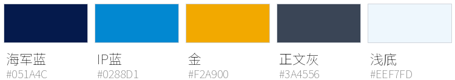

| 首屏 | 完整长图 |
|---|---|
|  | <a href="docs/previews/1-miaolan-full.jpg"></a><br>点击查看完整长图 |

### ② 暖纸编辑 · 测评风（`nuanzhi`）

- **适合文章**：案例复盘、观点长文、深度测评
- **示例文章**：《同部位复发，第二笔重疾为什么一分不给》
- **核心组件**：杂志式刊头（大期号）、牛皮纸案卷、宋体导语、大号章节号、荧光笔笔记卡、对比擂台表、打分进度条、宋体金句

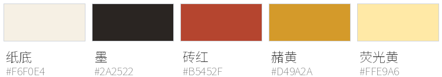

| 首屏 | 完整长图 |
|---|---|
|  | <a href="docs/previews/2-nuanzhi-full.jpg"></a><br>点击查看完整长图 |

### ③ 深蓝鎏金 · 数据测算（`shenlan`）

- **适合文章**：养老 / 年金 / 分红 / 退休现金流 / 医保档位算账
- **示例文章**：《同部位复发，第二笔重疾为什么一分不给》
- **核心组件**：深蓝头图＋三格关键指标、PART 章节、条款规格卡、深色数据面板、深蓝算账板＋双格大数字、金字表头、金框判断线

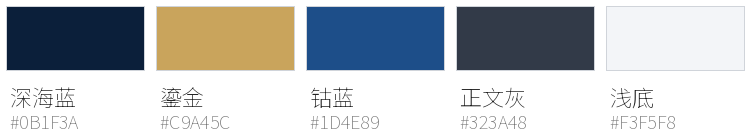

| 首屏 | 完整长图 |
|---|---|
|  | <a href="docs/previews/3-shenlan-full.jpg"></a><br>点击查看完整长图 |

### ④ IP蓝瑞士网格 · 清单指南（`wangge`）

- **适合文章**：选购指南、清单、「先看什么后看什么」
- **示例文章**：《同样叫0免赔，有的一款全额赔有的一款只报80%》
- **核心组件**：粗线刊头＋三格元信息、大号编号章节、数字网格 grid、粗细线表格、方头进度条、顺序清单 seq、编号条款卡

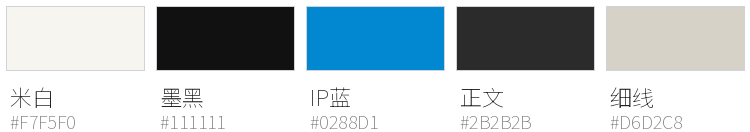

| 首屏 | 完整长图 |
|---|---|
|  | <a href="docs/previews/4-wangge-full.jpg"></a><br>点击查看完整长图 |

### ⑤ 保单体检报告单 · 诊断排查（`tijian`）

- **适合文章**：保单诊断、条款避坑排查、政策/条款原文逐段解读
- **示例文章**：《保证续保20年，保的只是不被单独踢出去》
- **核心组件**：报告单抬头＋图例、检验依据、检验项目表 report（✓/!/✕）、样本原文＋判读、红框异常标签 chips、计算单、诊断意见 Rx、体检结论

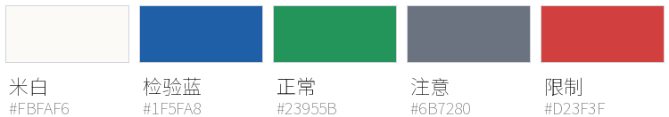

| 首屏 | 完整长图 |
|---|---|
|  | <a href="docs/previews/5-tijian-full.jpg"></a><br>点击查看完整长图 |

### ⑥ 黑板荧光笔 · 知识笔记（`heiban`）

- **适合文章**：医保怎么选、名词解释、一个公式讲清楚
- **示例文章**：《居民医保交一档还是二档，一次住院就能算清》
- **核心组件**：黑板头图、红圈序号章节、荧光半截划重点、便签名词卡、公式板 formula、黑板推演 calc（粉笔圈数字）、板书表、易错框

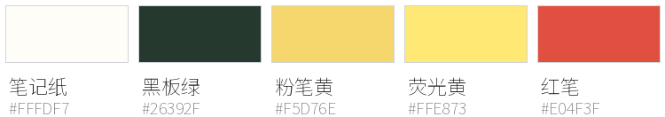

| 首屏 | 完整长图 |
|---|---|
|  | <a href="docs/previews/6-heiban-full.jpg"></a><br>点击查看完整长图 |

### ⑦ 测评擂台 · 产品横评（`leitai`）

- **适合文章**：多款横评、两款 PK、单品拆解
- **示例文章**：《保费差不到100块的重疾险，赔的钱能差一半》
- **核心组件**：擂台黑头图＋同口径说明、ROUND 回合章节、选手卡 roster、红蓝对阵表 vs、单品卡 card、分项条、黑表头横评表、犯规提醒

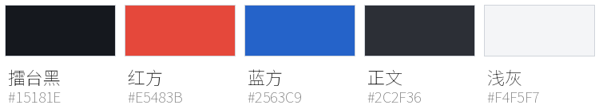

| 首屏 | 完整长图 |
|---|---|
|  | <a href="docs/previews/7-leitai-full.jpg"></a><br>点击查看完整长图 |

### ⑧ 选购清单 · 产品列表推荐（`xuangou`）

- **适合文章**：月度选购清单、按需求分类的产品列表、「这几类各看哪几款」的推荐型文章
- **示例文章**：《重疾险·医疗险选购清单》（移植自喵叔长图模板的同名示例，附原文 `examples/重疾医疗选购清单.md`）
- **核心组件**：海军蓝头图＋金色大月份＋英文副标、色块天际线、白色分类胶囊（自动统计「分类 N款」）、彩色分类横幅（6 色轮换）、产品卡（左侧分类色条、✓ 圆标、示例角标、彩色标签要点、「适合人群」浅底高亮）、顾问沟通提醒框、深海军蓝「重要提示」页脚

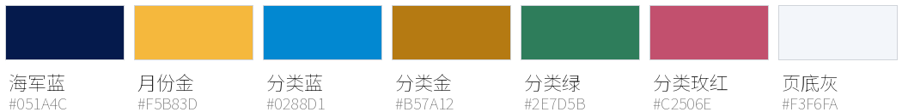

| 首屏 | 完整长图 |
|---|---|
|  | <a href="docs/previews/8-xuangou-full.jpg">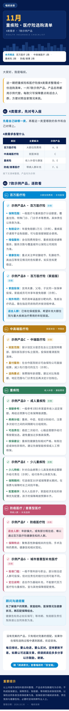</a><br>点击查看完整长图 |

## 产品列表组件 `::: products`

选购清单类文章的主组件。8 套主题都能用（⑧ 选购清单是完整版，①–⑦ 为通用版并自动换色）：

```
::: products 分类名 | 分类说明标签 | 头图胶囊简称（可省） | #主色（可省，⑧ 默认 6 色轮换）
# 示例产品A · 百万医疗险 | 示例
- 保障范围：一般医疗与重疾医疗分设额度……
- 适合人群 | 已有社保或医保、希望补充大额住院费用的年轻家庭。
:::
```

- `# 产品名 | 角标`：一张产品卡，角标可省（虚构产品建议写「示例」）。
- `- 标签：正文` 或 `- 标签 | 正文`：卡内要点；标签含「适合」的要点铺浅底高亮。标签可省。
- 其他行：分类导语，排在产品卡前。
- ⑧ 额外读三个元信息：`@month`（金色大月份，如 `11月`）、`@sub`（副标题）、`@en`（英文小字）；头图胶囊按各分类自动生成「简称 N款」。
- 用 spec 拼稿时可行内引用原文段落：`# <<3>> | 示例`、`- <<4>>`。
- 产品文案避开「最高 / 第一 / 唯一 / 排行榜 / 排名」，用「推荐 / 适合」；参数、角标属于排版新加文字，会被严格查禁用词。

## 命令速查

```bash
python3 scripts/build.py tijian examples/保证续保.gzh.md                     # 单套
python3 scripts/build.py all examples/同部位复发.gzh.md                      # 8 套全出，对比效果
python3 scripts/build.py xuangou examples/重疾医疗选购清单.gzh.md --src examples/重疾医疗选购清单.md

# 排自己的文章：先拼标记稿，再带原文构建（原文覆盖比对 + 原文禁用词降级为提示）
python3 scripts/compose.py --dump 我的文章.md       # 看原文段落编号
python3 scripts/compose.py 我的文章.spec            # 生成 我的文章.gzh.md
python3 scripts/build.py miaolan 我的文章.gzh.md --src 我的文章.md --out output/我的文章
python3 scripts/make_previews.py                    # 重出 docs/previews/ 全部预览图
```

产物（默认在 `output/<标记稿名>/<主题id>/`）：

| 文件 | 用途 |
|---|---|
| `article.html` | 浏览器打开，点「复制到公众号」，到编辑器 Ctrl/⌘+V |
| `body.html` | 干净正文 HTML |
| `preview.png` | 375px 手机宽 2x 长图 |
| `check.txt` | 校验报告：ERROR / WARN、锚点次数、原文覆盖、版面自检 |

标记稿语法见 [templates/标记语法.md](templates/标记语法.md)，可从 [templates/示例标记稿.gzh.md](templates/示例标记稿.gzh.md) 起步。

## 目录结构

```
miaoshu-gzh-design/
├── SKILL.md              Agent 入口：工作流、分工表、平台限制、合规规则
├── README.md
├── LICENSE               MIT
├── requirements.txt
├── engine/               引擎
│   ├── parse.py          标记稿解析（含 ::: products 产品列表）
│   ├── base.py           组件基类（内联样式、leaf 包裹、孤字保护、未知组件降级）
│   ├── builder.py        构建：标记稿 → body / article / preview / check
│   ├── checker.py        校验：平台限制、leaf、半角标点、禁用词、免责
│   ├── source.py         原文读取与覆盖比对
│   ├── shot.py           截图与 375px 版面自检
│   └── page.py           带复制按钮的预览页模板
├── themes/               8 套主题（②–⑧ 继承 ① 的组件并换色）
├── templates/            标记语法说明 + 示例标记稿
├── examples/             6 篇示例标记稿（⑧ 附原文与 spec）
├── scripts/              build / validate / screenshot / compose / make_previews
├── docs/
│   ├── THEMES.md         主题详解与配方
│   └── previews/         首屏、长图、色板、总览图
└── fonts/                截图用中文字体说明（字体文件不入库）
```

## 保险合规

- **禁用词**：回本、取钱、利息、本金、保本、稳赚、零风险、收益 / 收益率 / 回报率、复利、比存款、停售 / 窗口期、最高、第一、唯一、排行榜、排名。排版新加的文字出现即 ERROR；**原文里本来就有的只在报告里列出，不改原文**，由作者决定是否改稿。
- **替换建议**：复利 → IRR；回本 → 现价超过已交保费；收益 → 利益 / 演示利益。
- **需人工确认**：保证续保、首选、最好、最值得、必买、闭眼。
- **免责必含**「以保险合同条款及核保结果为准」。

## 致谢

- 方法论与 README 结构参考 [isjiamu/gzh-design-skill](https://github.com/isjiamu/gzh-design-skill)（克制用色、按文章类型配方、平台限制清单、校验思路），**代码与文字均独立编写**，未复制其代码或文案。
- ⑧ 选购清单的视觉移植自喵叔自己的长图排版模板（2026-10-30「重疾险·医疗险选购清单」）。
- 截图字体使用思源黑体 / 思源宋体（Noto Sans SC / Noto Serif SC，SIL OFL 1.1），不随仓库分发。

## 许可

代码与主题以 [MIT](LICENSE) 许可发布。`examples/` 中的文章内容版权归「喵叔说保」所有，仅作排版示例；文中产品仅作条款举例或为虚构示例，不构成任何购买推荐。

## 关于作者 / 联系喵叔

这套排版是喵叔给自己的公众号「喵叔说保」做的，开源出来，希望别的行业也能直接用上。用的时候遇到问题、想定制一套自己行业的主题，或者想聊内容合作，都欢迎来找我。

<p align="center"></p>

<p align="center"><br><b>关注公众号「喵叔说保」</b><br>看这套排版在真实文章里的样子</p>

<p align="center">名片上的二维码是喵叔的个人微信：各行业的公众号排版、内容合作都可以聊，加好友时备注「GitHub」。</p>
